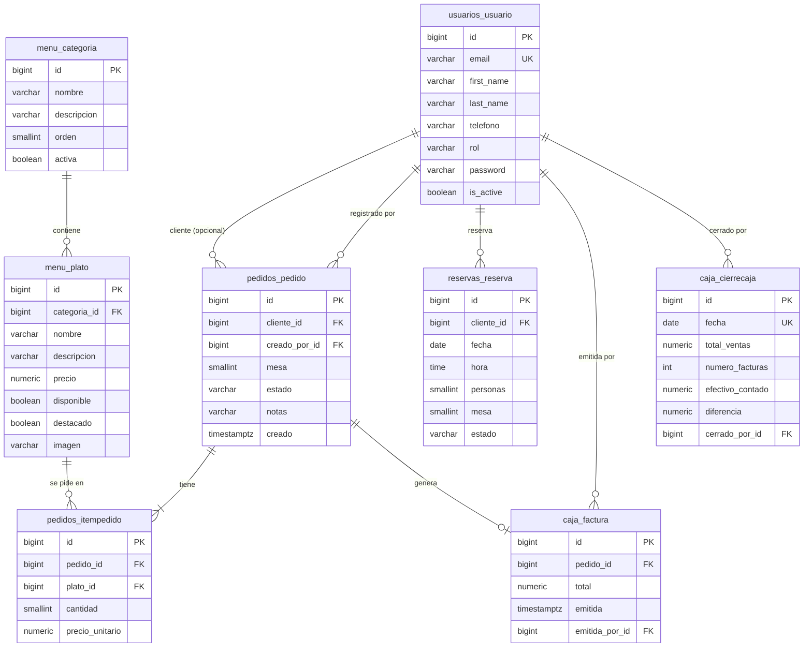

# Estructura de la base de datos

Motor: **PostgreSQL**. Las tablas las crea Django con las migraciones de cada app (`python manage.py migrate`).
Este documento describe las tablas propias del sistema; Django agrega además sus tablas internas (`auth_*`, `django_*`).

## Diagrama entidad–relación

## Diccionario de datos

Convenciones: todas las claves primarias son `bigint` autoincrementales. Las columnas «Obligatorio» no admiten nulos.
Todas las columnas de texto se validan y normalizan en los formularios antes de guardarse (ver [arquitectura](arquitectura.md)).

### `usuarios_usuario` — Cuentas del sistema (app `usuarios`)

| Columna | Tipo | Obligatorio | Descripción y reglas |
|---|---|---|---|
| `id` | bigint | Sí | Clave primaria |
| `email` | varchar(254) | Sí | Correo; **único** y guardado en minúsculas. Es el usuario de acceso |
| `password` | varchar(128) | Sí | Contraseña cifrada (PBKDF2) |
| `first_name` | varchar(60) | Sí | Nombre; solo letras, espacios, guion y apóstrofo |
| `last_name` | varchar(60) | Sí | Apellido; mismas reglas |
| `telefono` | varchar(16) | No | De 7 a 15 dígitos, con `+` opcional al inicio |
| `rol` | varchar(15) | Sí | `cliente` (por defecto), `mesero` o `administrador` |
| `is_active` | boolean | Sí | Un usuario inactivo no puede iniciar sesión |
| `is_staff`, `is_superuser` | boolean | Sí | Acceso al sitio de administración de Django |
| `last_login`, `date_joined` | timestamptz | No / Sí | Auditoría de acceso |

### `menu_categoria` — Categorías del menú (app `menu`)

| Columna | Tipo | Obligatorio | Descripción y reglas |
|---|---|---|---|
| `id` | bigint | Sí | Clave primaria |
| `nombre` | varchar(60) | Sí | Único sin distinguir mayúsculas (restricción `categoria_nombre_unico_ci`) |
| `descripcion` | varchar(200) | No | Texto sin `<` ni `>` |
| `orden` | smallint | Sí | De 0 a 999; ordena la carta |
| `activa` | boolean | Sí | Una categoría oculta no aparece en la carta ni en los pedidos |

### `menu_plato` — Platos (app `menu`)

| Columna | Tipo | Obligatorio | Descripción y reglas |
|---|---|---|---|
| `id` | bigint | Sí | Clave primaria |
| `categoria_id` | bigint | Sí | FK → `menu_categoria` (`PROTECT`: no se borra una categoría con platos) |
| `nombre` | varchar(100) | Sí | Único por categoría sin distinguir mayúsculas (`plato_nombre_unico_por_categoria_ci`) |
| `descripcion` | varchar(500) | No | Texto sin `<` ni `>` |
| `precio` | numeric(9,2) | Sí | Mayor que 0 y hasta 9.999.999,99 |
| `disponible` | boolean | Sí | Un plato agotado no aparece en la carta ni se puede pedir |
| `destacado` | boolean | Sí | Si es verdadero, aparece en «Platos destacados» del inicio (máximo 6) |
| `imagen` | varchar(100) | No | Ruta de la foto dentro de `media/platos/` (nombre aleatorio). JPG, PNG o WebP reales de hasta 2 MB y 4000 px por lado |
| `creado`, `actualizado` | timestamptz | Sí | Auditoría |

La base guarda solo la **ruta** de la foto; el archivo vive en la carpeta `media/`. Al reemplazar la foto o eliminar el plato, el archivo anterior se borra.

### `pedidos_pedido` — Pedidos (app `pedidos`)

| Columna | Tipo | Obligatorio | Descripción y reglas |
|---|---|---|---|
| `id` | bigint | Sí | Clave primaria; es el número del pedido |
| `cliente_id` | bigint | No | FK → `usuarios_usuario`. Vacío si lo registró el personal para una mesa |
| `creado_por_id` | bigint | Sí | FK → `usuarios_usuario`: quién lo registró |
| `mesa` | smallint | Sí | De 1 a 99 |
| `estado` | varchar(15) | Sí | `pendiente` → `en_preparacion` → `listo` → `servido` → `cerrado`; o `cancelado` (solo desde `pendiente`) |
| `notas` | varchar(200) | No | Texto sin `<` ni `>` |
| `creado`, `actualizado` | timestamptz | Sí | Auditoría |

### `pedidos_itempedido` — Platos de cada pedido (app `pedidos`)

| Columna | Tipo | Obligatorio | Descripción y reglas |
|---|---|---|---|
| `id` | bigint | Sí | Clave primaria |
| `pedido_id` | bigint | Sí | FK → `pedidos_pedido` (`CASCADE`) |
| `plato_id` | bigint | Sí | FK → `menu_plato` (`PROTECT`: no se borra un plato con pedidos) |
| `cantidad` | smallint | Sí | De 1 a 50 (`item_cantidad_en_rango`) |
| `precio_unitario` | numeric(9,2) | Sí | Precio del plato **al momento de pedir**; no cambia si el plato cambia de precio |

Restricción `item_unico_por_plato_y_pedido`: un plato aparece una sola vez por pedido.

### `reservas_reserva` — Reservas (app `reservas`)

| Columna | Tipo | Obligatorio | Descripción y reglas |
|---|---|---|---|
| `id` | bigint | Sí | Clave primaria |
| `cliente_id` | bigint | Sí | FK → `usuarios_usuario` |
| `fecha` | date | Sí | Entre hoy y 30 días adelante al reservar |
| `hora` | time | Sí | Franjas de 30 minutos entre 11:00 y 20:00; la reserva dura 2 horas |
| `personas` | smallint | Sí | De 1 a 12 |
| `mesa` | smallint | Sí | De 1 a 99 |
| `estado` | varchar(12) | Sí | `pendiente` → `confirmada` → `completada`; o `cancelada` |
| `notas` | varchar(200) | No | Texto sin `<` ni `>` |
| `creado`, `actualizado` | timestamptz | Sí | Auditoría |

Índice `(mesa, fecha)` para validar cruces. Los cruces (misma mesa, o mismo cliente, a menos de 2 horas) se impiden en el servicio de reservas, con bloqueo de PostgreSQL para evitar carreras.

### `caja_factura` — Facturas (app `caja`)

| Columna | Tipo | Obligatorio | Descripción y reglas |
|---|---|---|---|
| `id` | bigint | Sí | Clave primaria. El número de factura es `F-` + el `id` con 6 dígitos (`F-000001`) |
| `pedido_id` | bigint | Sí | FK **única** → `pedidos_pedido` (`PROTECT`): una factura por pedido |
| `total` | numeric(14,2) | Sí | Total del pedido congelado al cerrarlo |
| `emitida` | timestamptz | Sí | Fecha y hora de emisión; define el día de ventas |
| `emitida_por_id` | bigint | Sí | FK → `usuarios_usuario` |

### `caja_cierrecaja` — Cierres de caja (app `caja`)

| Columna | Tipo | Obligatorio | Descripción y reglas |
|---|---|---|---|
| `id` | bigint | Sí | Clave primaria |
| `fecha` | date | Sí | **Única**: la caja de un día se cierra una sola vez |
| `total_ventas` | numeric(14,2) | Sí | Suma de las facturas emitidas ese día |
| `numero_facturas` | integer | Sí | Cantidad de facturas de ese día |
| `efectivo_contado` | numeric(14,2) | Sí | Efectivo registrado por el administrador |
| `diferencia` | numeric(14,2) | Sí | `efectivo_contado − total_ventas` (negativo = faltante) |
| `observaciones` | varchar(200) | No | Texto sin `<` ni `>` |
| `cerrado_por_id` | bigint | Sí | FK → `usuarios_usuario` |
| `cerrado` | timestamptz | Sí | Fecha y hora del cierre |

Un cierre es **inmutable**: el modelo impide modificarlo y eliminarlo, y el sitio de administración no ofrece esas acciones.

## Integridad referencial

| Relación | Al borrar el padre |
|---|---|
| Plato → Categoría | `PROTECT` |
| Ítem → Plato | `PROTECT` |
| Ítem → Pedido | `CASCADE` |
| Pedido → Usuario (cliente y registrado por) | `PROTECT` |
| Reserva → Usuario | `PROTECT` |
| Factura → Pedido, Factura → Usuario | `PROTECT` |
| Cierre → Usuario | `PROTECT` |

Para dejar de usar un usuario, un plato o una categoría se **desactivan** (`is_active`, `disponible`, `activa`) en lugar de borrarlos, para conservar el historial.

## Migraciones

| App | Migración | Contenido |
|---|---|---|
| `usuarios` | `0001_initial` | Modelo de usuario propio |
| `menu` | `0001_initial` | Categorías y platos |
| `menu` | `0002_plato_foto_y_destacado` | Foto y marca de destacado del plato |
| `pedidos` | `0001_initial` | Pedidos e ítems |
| `reservas` | `0001_initial` | Reservas |
| `caja` | `0001_initial` | Facturas y cierres de caja |

Las pruebas automáticas verifican que no falten migraciones (`makemigrations --check`).
